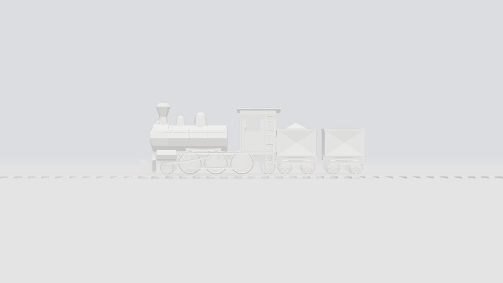
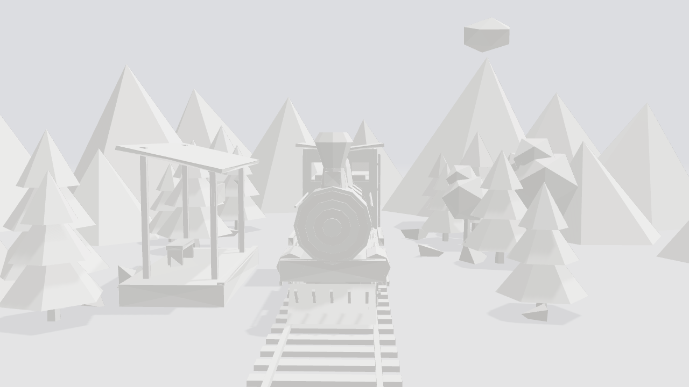

# Origami Train — Spline scene

A 3D rebuild of the origami train video: a white folded-paper steam train
(exposed spoked wheels, coupling rods, side ladders, smokestack, domes,
hollow cab with a control station) on a paper track. It floats in a seamless
studio, then the camera swings round to a front view and an origami landscape
(station, mountains, trees, rocks, cloud) unfolds around it.

| Side (studio hero shot) | Front (station shot) |
|---|---|
|  |  |

## Files

- `origami-train.glb`: the model, ready to import into Spline.
- `scene.js`: procedural source of the model (three.js). Every part is named.
- `export-glb.mjs`: regenerates the GLB (`npm install && npm run export`).

Object hierarchy inside the GLB:

```
OrigamiTrainDiorama
├── Hero
│   ├── Train
│   │   ├── Locomotive   (Boiler, Smokebox, Stack*, Domes, Wheels, Rods, Pilot…)
│   │   │   └── Cab      (walls, roof, Ladder_Left/Right, ControlStation)
│   │   ├── Tender
│   │   └── Wagon
│   └── Track            (Rails, Sleepers)
└── Landscape            (Station, Mountain_*, PineTree_*, RoundTree_*, Rock_*, Cloud)
```

## Building it in Spline

### 1. Import
1. Create a new Spline file, then delete the default cube and light.
2. **File → Import** (or drag and drop) `origami-train.glb`.
3. Select `OrigamiTrainDiorama` and set its position to `0, 0, 0`.

### 2. Paper material
Select all meshes and give them one shared material:
- **Layers:** Color `#F4F3EF`, then Lighting set to **Physical**, roughness 0.9, metalness 0.
- Optional: add a **Noise** layer (Simplex, scale about 200, opacity 4%) for paper fibre.

The geometry is faceted (flat normals), so the folds and creases read
without any extra setup. The darker paper tones on the creases come from the
GLB's material colours, so keep those if you want the extra contrast.

### 3. Seamless studio (no background)
- **Scene → Background:** `#DCDDE1`.
- Add a **Plane** 300 × 300 at Y `-0.17`, with the same colour and *Receive Shadows* on.
- **Scene → Fog:** on, colour `#DCDDE1`, near 30, far 70. This blends the floor into the background so the horizon disappears.

### 4. Soft, even studio lighting
- **Directional light** at `2, 14, 5`, intensity 1.6, *Cast Shadows* on, shadow softness high. Coming from almost straight above, it puts the soft shadow directly under the product.
- **Ambient light** intensity about 0.8, white.
- Turn on *Cast/Receive Shadows* for `Hero` and `Landscape`.

### 5. Camera: straight-on and perfectly level
- Perspective camera, **FOV about 20** (a long lens keeps the side view flat and product-like).
- **State "Side":** position `0, 1.2, 30`, rotation `0, 0, 0`. Camera Y equals the target Y, so the view is perfectly level and the train sits dead centre.
- **State "Front":** position `-13, 2.6, 0.4`, looking down the track at `3, 1.2, 0` (rotation about `-5°, -90°, 0`). FOV 32.

### 6. Animation (matches the video)
Create these states and events. *Start* fires on load; chain them with delays.

| Time | Object | From → To |
|---|---|---|
| 0–3 s | Camera | hold **Side** |
| 0–3 s | `Hero` | Y `0.35` ↔ `0.45`, a slow float loop (ease in-out, mirror) |
| 0–3 s | `Landscape` | hidden: scale `0` |
| 3–6 s | Camera | **Side → Front**, 3 s, ease in-out |
| 3–4.5 s | `Hero` | Y `0.4 → 0` (settles onto the ground) |
| 3.5–6 s | `Landscape` children | scale `0 → 1`, spring, staggered 0.05 s each, nearest items first (Station, then trees and rocks, then mountains, then the cloud) |
| 6 s → | `Cloud` | Y ±0.15 float loop |

For extra life, put a slow Z-rotation loop on the `*Wheel*` groups and a
puff of low-poly icosahedrons (scale up, fade out) above `StackCrown`.

### 7. Export
**Export → Code / Viewer** (or Image/Video for a render). For a still,
use the Side state at 4K with shadows on.

## Regenerating the model

```bash
npm install
npm run export   # writes origami-train.glb
```

Tweak sizes, part counts or the landscape layout in `scene.js`. The layout is
seeded, so every export is identical.
